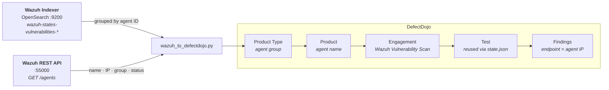

# wazuh-defectdojo

Imports vulnerability findings from the Wazuh Indexer (OpenSearch) into
[DefectDojo](https://github.com/DefectDojo/django-DefectDojo), **one product per agent**, enriched
with agent IP, group and status from the Wazuh REST API.

Wazuh detects vulnerable packages on every enrolled host, but its own interface is built for
monitoring rather than remediation tracking. This script moves those findings into DefectDojo so
they can be triaged, assigned and closed alongside everything else, with each agent mapped to its
own product so ownership stays clear.

Runs unattended on a cron schedule, keeps incremental state, and is safe to re-run.

## Data flow



First run: `import-scan/` creates a new Test and stores `{test_id, name}` in `state.json`.
Subsequent runs: `reimport-scan/` updates the existing Test, closing resolved findings and adding
new ones.

## Prerequisites

- Python 3.10 or newer
- DefectDojo 2.x with an API token
- Network access from the host running this script to:
  - Wazuh Indexer port 9200
  - Wazuh Manager API port 55000
- A Wazuh Indexer user (e.g. `defectdojo-indexer`) with read access to `wazuh-states-vulnerabilities-*`
- A custom role (e.g. `wazuh-readonly`) created under **Security → Roles** and mapped to that user
- A Wazuh API user (e.g. `dd-agent-reader`) with `agents:read` permission

> `readall` is a reserved role in the Wazuh Indexer and cannot be mapped. You have to create a
> custom role.

## Configuration

```bash
cp .env.example .env
```

| Variable | Description |
|---|---|
| `OPENSEARCH_HOST` | Wazuh Indexer IP or hostname |
| `OPENSEARCH_PORT` | OpenSearch port (default: `9200`) |
| `OPENSEARCH_USER` | Indexer read user |
| `OPENSEARCH_PASS` | Password set when creating the user |
| `WAZUH_API_URL` | Wazuh Manager API base URL, including port 55000 |
| `WAZUH_API_USER` | Wazuh API user |
| `WAZUH_API_PASS` | Wazuh API password (keep it ASCII-safe, avoid `!`, `£`, `$`) |
| `DD_URL` | DefectDojo base URL |
| `DD_TOKEN` | DefectDojo API token (Profile → API v2 Key) |
| `DD_MIN_SEVERITY` | Minimum severity to import (default: `Low`) |
| `STATE_FILE` | Path to state JSON (default: `./state.json`) |

## Usage

```bash
pip3 install -r requirements.txt
cp .env.example .env     # then fill in the values
set -a && . ./.env && set +a
python3 wazuh_to_defectdojo.py
```

### Scheduling

```cron
0 4 * * * cd /opt/scripts/wazuh-defectdojo && set -a && . ./.env && set +a && python3 wazuh_to_defectdojo.py >> /var/log/wazuh-to-dd.log 2>&1
```

## Enrolling agents

[`agent-install/`](agent-install) holds an unattended Wazuh agent installer for Ubuntu 22.04. Run
it once per host you want collected:

```bash
sudo WAZUH_MANAGER=<manager_ip> AGENT_NAME=<host_name> bash agent-install/install_wazuh_agent.sh
```

Pick `AGENT_NAME` deliberately: it becomes the DefectDojo product name. See
[`agent-install/README.md`](agent-install/README.md) for details, including the Windows service
name gotcha.

## State file

`state.json` maps each agent ID (stable across renames) to its test ID and current name:

```json
{
  "006": {"test_id": 4, "name": "APP-SRV-01"},
  "009": {"test_id": 7, "name": "mon-srv-01"}
}
```

Keying on agent ID rather than name is what lets the script survive renames. It handles these
cases on its own:

| Scenario | Behaviour |
|---|---|
| Agent renamed | Product renamed in DefectDojo to match |
| Agent moved to a different group | Product type updated in DefectDojo |
| Agent disconnected, no current findings | Import skipped, existing findings preserved |
| `state.json` lost | Existing test recovered from the DefectDojo API before creating a new one |

Delete `state.json` to force a full reimport as a fresh test, which is useful after a schema change
or a full reset.

## Product type mapping

The Wazuh agent **group** becomes the DefectDojo product type:

- Group `default` → product type `Endpoints`
- Any other group → product type = group name (e.g. `servers-linux`, `windows-workstations`)

Assign agents to meaningful groups in the Wazuh dashboard and the categorisation follows
automatically.

## Severity filtering

Info-level findings are skipped at source (`SKIP_SEVERITIES = {"untriaged", "none", "-", "info"}`).
`DD_MIN_SEVERITY` additionally filters Low findings; the default allows Low and above.

## Enriched description fields

Each finding description includes, where available:

- OS full version (`host.os.full`)
- Package path, license and architecture
- CVSS temporal/environmental score fallback
- Fix condition (`vulnerability.scanner.condition`)
- Data source (`vulnerability.scanner.source`)
- Wazuh manager name and agent version

## Troubleshooting

| Symptom | Cause | Fix |
|---|---|---|
| `ConnectionError` on port 9200 | Firewall blocks the script's host from reaching the Indexer | Open port 9200 for that source IP |
| `AuthorizationException` | Indexer user missing index permissions | Check the role mapping under Security → Roles |
| `Could not build agent cache` | Wazuh API unreachable or wrong credentials | Check `WAZUH_API_URL`, that port 55000 is open, and that the password has no shell-special characters |
| Agent cache: 0 entries | Token acquired but invalid (missing `?raw=true`) | Verify `WAZUH_API_PASS` contains no `!` or `£`; test manually with `curl` |
| All findings reimported as new | `state.json` deleted or corrupted | The script recovers the existing test from DefectDojo automatically |
| `DD_TOKEN` KeyError | `.env` not sourced | Run `set -a && . ./.env && set +a` first |
| Import timeout | Large agent (10k+ findings) exceeds 60s | Already handled; the import timeout is set to 600s |

## Related

Part of a set of integrations around DefectDojo and OpenCTI:

| Repository | Direction |
|---|---|
| [`kaspersky-defectdojo`](https://github.com/Tekila11/kaspersky-defectdojo) | Kaspersky Security Center → DefectDojo |
| [`opencti-defectdojo`](https://github.com/Tekila11/opencti-defectdojo) | DefectDojo ↔ OpenCTI, both directions |
| [`opencti-vuln-toolkit`](https://github.com/Tekila11/opencti-vuln-toolkit) | OpenCTI connectors for CVE enrichment and scoring |

## License

[MIT](LICENSE)
